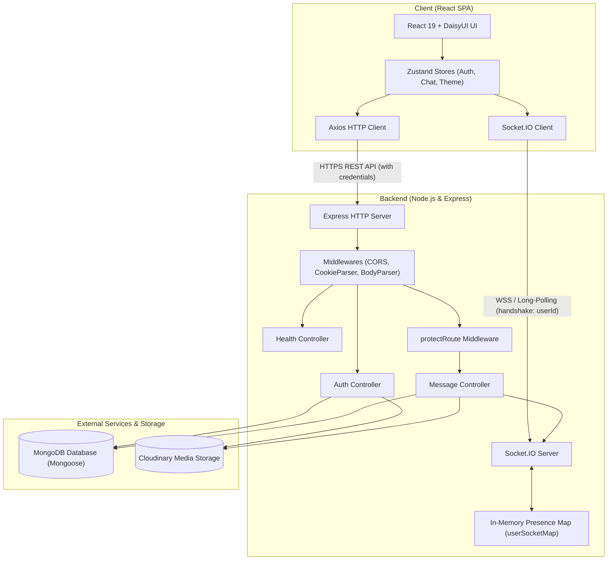
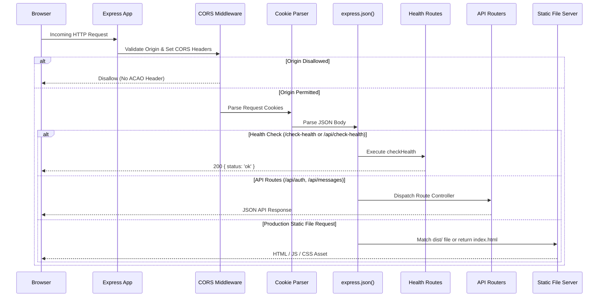
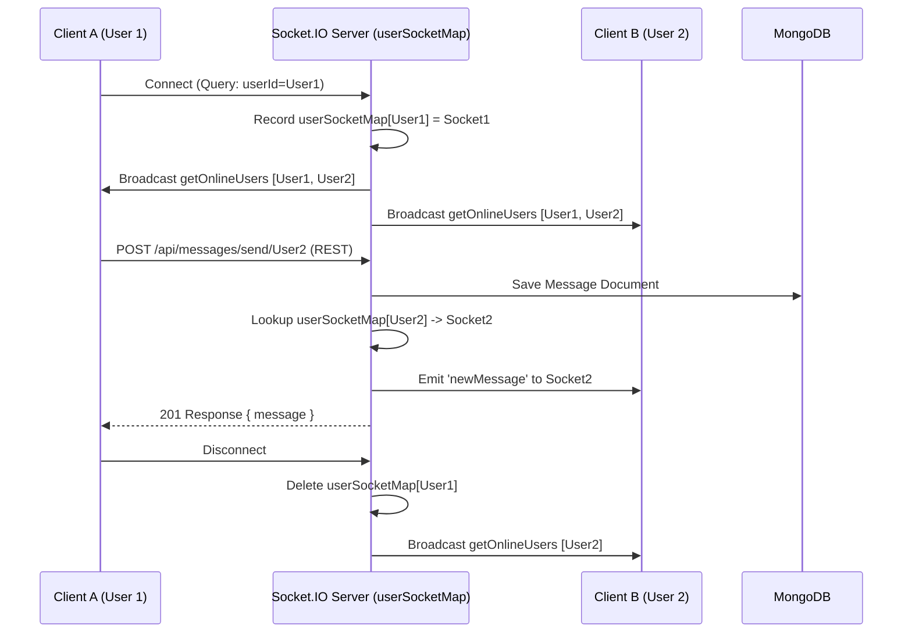

# Chat App — Technical Architecture & Implementation Design

This document details the technical architecture, implementation decisions, component relationships, data flow, security model, and deployment strategy for the Chat App.

For product requirements and API contracts, see [docs/SPEC.md](file:///home/pupil/chat-app/docs/SPEC.md).

---

## 1. High-Level Architecture Overview

The Chat App is a fullstack, event-driven web application designed for real-time 1-to-1 messaging. It follows a decoupled client-server architecture organized in a single monorepo:

- **Client**: A Single Page Application (SPA) built with React 19, Vite, Tailwind CSS, DaisyUI, and Zustand.
- **Server**: A Node.js backend using Express for RESTful endpoints and Socket.IO for duplex WebSocket communication.
- **Persistence**: MongoDB (via Mongoose ODM) for persistent relational-style document storage.
- **Media Storage**: Cloudinary CDN for storing user profile avatars and chat image attachments.
- **Hosting & Deployment**: Render web service hosting both static frontend distribution assets and Node.js backend processes in production.



---

## 2. Technology Stack & Key Decisions

| Layer / Concern | Technology | Architectural Rationale |
|---|---|---|
| **Frontend Framework** | React 19 | Declarative component model, concurrent rendering support, modern hooks. |
| **Build Tool** | Vite 6 | Rapid Hot Module Replacement (HMR), optimized Rollup production bundling. |
| **Styling & UI** | Tailwind CSS + DaisyUI | Utility-first styling with comprehensive plug-and-play semantic component classes and built-in CSS variable theme switching. |
| **Client State** | Zustand | Lightweight, hook-based state management without boilerplate; allows actions to interact with Socket.IO client directly outside React lifecycle. |
| **Client HTTP** | Axios | Automatic JSON serialization, centralized configuration (`baseURL`, `withCredentials`), consistent error handling. |
| **Backend Runtime** | Node.js (ES Modules) | Native `import`/`export` syntax, asynchronous event loop suited for I/O-intensive real-time chat. |
| **Web Framework** | Express 4 | Minimalist, unopinionated HTTP routing and middleware framework. |
| **Real-Time Engine** | Socket.IO 4 | WebSocket transport with automatic long-polling fallback, room/client targeting, heartbeats, and connection state management. |
| **Database & ODM** | MongoDB + Mongoose 8 | Document database with JSON-like structure matching application domain; Mongoose provides schema validation and query helpers. |
| **Authentication** | JWT (`jsonwebtoken`) + `bcryptjs` | Stateless authentication stored in HTTP-only cookies; password hashing with 10 salt rounds. |
| **Image Hosting** | Cloudinary SDK v2 | Direct-to-cloud media hosting and CDN optimization, eliminating server file system storage burdens. |

---

## 3. Monorepo Structure & Module Boundaries

The repository is organized as a monorepo containing frontend and backend workspaces alongside shared project guidance:

```
chat-app/
├── package.json              # Monorepo root scripts (build & start)
├── README.md                 # Project introduction and setup guide
├── AGENTS.md                 # Agent development guidelines and git workflow
├── docs/
│   ├── SPEC.md               # Product requirements and system specification
│   └── ARCHITECTURE.md       # Technical architecture (this document)
├── backend/
│   ├── package.json          # Node.js backend dependencies and scripts
│   ├── .env                  # Backend environment configuration
│   └── src/
│       ├── index.js          # Server entry point, middleware assembly, static hosting
│       ├── controllers/      # Request handlers (auth, message, health)
│       ├── middleware/       # Express middlewares (auth protection)
│       ├── models/           # Mongoose schemas (User, Message)
│       ├── routes/           # REST endpoint routers (auth, message, health)
│       ├── seed/             # Database seed scripts
│       └── lib/
│           ├── cors.js       # Centralized CORS resolution and options
│           ├── db.js         # MongoDB connection helper
│           ├── socket.js     # Socket.IO initialization and online presence map
│           ├── cloudinary.js # Cloudinary SDK configuration
│           └── utils.js      # JWT generation and cookie helpers
└── frontend/
    ├── package.json          # Vite React frontend dependencies and scripts
    ├── vite.config.js        # Vite configuration
    ├── index.html            # SPA entry HTML
    ├── src/
    │   ├── main.jsx          # React DOM root render
    │   ├── App.jsx           # Top-level routing, auth check, theme listener
    │   ├── constants/        # Theme definitions and app constants
    │   ├── components/       # Reusable UI components (Navbar, ChatContainer, Sidebar)
    │   ├── pages/            # Page-level views (LandingPage, HomePage, LoginPage, SignUpPage, ProfilePage, SettingsPage)
    │   ├── store/            # Zustand global stores (useAuthStore, useChatStore, useThemeStore)
    │   └── lib/              # Frontend utilities (axios instance, date formatting)
    └── dist/                 # Production build artifacts (generated by Vite)
```

---

## 4. Frontend Architecture

### 4.1 State Management (Zustand)

Global state is divided into three focused stores:

1. **`useAuthStore`**:
   - Manages authenticated user state (`authUser`), authentication flags (`isSigningUp`, `isLoggingIn`, `isCheckingAuth`), and the active Socket.IO connection.
   - Lifecycle: Initiates `checkAuth()` on application load (`/api/auth/check-auth`). On success, it calls `connectSocket()`.
   - Socket synchronization: Connects with query param `userId: authUser._id`, listens for `getOnlineUsers`, and updates `onlineUsers` state. Cleans up socket connection on logout.
2. **`useChatStore`**:
   - Manages contact list (`users`), active conversation (`selectedUser`), message history (`messages`), and loading states.
   - Real-time updates: `subcribeToMessages()` attaches a listener to the `newMessage` socket event. When a message from `selectedUser` arrives, it appends it to `messages`.
3. **`useThemeStore`**:
   - Manages UI theme selection across 32 DaisyUI themes.
   - Persists user choice in `localStorage` (`chat-theme`) and synchronizes the HTML root attribute `document.documentElement.setAttribute('data-theme', theme)`.

### 4.2 Network & API Client

- **Axios Instance** (`frontend/src/lib/axios.js`):
  - In development: resolves `baseURL` to `http://localhost:3000/api`.
  - In production: resolves `baseURL` to relative `/api` (served by the same Express host).
  - Configured with `withCredentials: true` to ensure JWT cookies are sent on every request.

---

## 5. Backend Architecture & Pipeline

### 5.1 Request Pipeline

Express executes middleware and routes in the following order:



### 5.2 Controller & Service Layer

1. **`auth.controller.js`**:
   - `signup`: Validates inputs, verifies unique email/username, hashes password with `bcryptjs`, saves user document, generates JWT, and sets cookie.
   - `login`: Verifies user existence, compares password hash, generates JWT, and sets cookie.
   - `logout`: Clears authentication cookie (`maxAge: 0`).
   - `updateProfile`: Validates image payload, uploads base64 string to Cloudinary (`cloudinary.uploader.upload`), and updates `profilePic` on the user document.
   - `checkAuth`: Returns sanitized authenticated user record (`req.user`).
2. **`message.controller.js`**:
   - `getUsersForSidebar`: Queries all users except `req.user._id`, omitting passwords (`-password`).
   - `getMessages`: Retrieves all messages between `senderId` and `userToChatId` ordered chronologically.
   - `sendMessage`: Optionally uploads image to Cloudinary, persists `Message` document in MongoDB, checks recipient presence via `getReceiverSocketId(receiverId)`, and emits `newMessage` event if the recipient is online.
3. **`health.controller.js`**:
   - `checkHealth`: Returns HTTP 200 with service status, uptime, and timestamp for uptime checks and orchestrators.

---

## 6. Real-Time WebSocket Architecture (Socket.IO)



### 6.1 State Management

- Socket connections run on the same HTTP server instance (`server = http.createServer(app)`).
- Online status is maintained in an in-memory hash map `userSocketMap: { [userId: string]: string }`.
- On connection: socket handshake reads `socket.handshake.query.userId`, records the active `socket.id`, and emits `getOnlineUsers` to all connected clients.
- On disconnection: `userId` is removed from `userSocketMap` and an updated list of online IDs is broadcast.

---

## 7. Security & CORS Architecture

### 7.1 Cross-Origin Resource Sharing (CORS) Strategy

The application uses a centralized CORS configuration (`backend/src/lib/cors.js`) shared between the Express HTTP app and Socket.IO:

1. **Origin Resolution**:
   - **Local Development**: `http://localhost:5173`, `http://localhost:3000`, `http://127.0.0.1:5173`, `http://127.0.0.1:3000`.
   - **Environment Variable (`CLIENT_URL`)**: Supports comma-separated origin strings with whitespace and trailing slash normalization.
   - **Render Deployments**: Automatically permits origins ending with `.onrender.com` (matching any Render web service subdomain) as well as `RENDER_EXTERNAL_URL` and `RENDER_EXTERNAL_HOSTNAME`.
   - **Non-Browser & Same-Origin**: Requests without an `Origin` header (health checks, server-to-server pings, curl) are permitted.
   - **Development Mode**: If `NODE_ENV !== 'production'`, all origins are permitted.
2. **Graceful Rejection Policy**:
   - Disallowed origins invoke `callback(null, false)`.
   - **Decision**: Passing an `Error` (e.g. `callback(new Error('Not allowed by CORS'))`) causes Express to trigger an unhandled 500 error and print stack traces to server logs. Invoking `callback(null, false)` instructs CORS middleware to omit `Access-Control-Allow-Origin`, allowing the client browser to enforce security without crashing the server.
3. **Credentials Support**:
   - Configured with `credentials: true` to allow transmission of HTTP-only authentication cookies across origins.

### 7.2 Session & Cookie Security

- **Token Type**: JSON Web Token signed with `process.env.JWT_SECRET` and a 7-day expiration.
- **Cookie Flags**:
  - `httpOnly: true`: Blocks client-side JavaScript access (`document.cookie`), mitigating XSS-based session hijacking.
  - `sameSite: "strict"`: Defends against Cross-Site Request Forgery (CSRF).
  - `secure: process.env.NODE_ENV !== "development"`: Enforces HTTPS transmission in production environments.

---

## 8. Deployment & Production Build Architecture (Render)

### 8.1 Monorepo Build Pipeline

The root `package.json` coordinates building both frontend and backend for deployment on platforms like Render:

```bash
# Build Command
npm run build
# Executes: npm install --prefix backend && npm install --prefix frontend && npm run build --prefix frontend

# Start Command
npm start
# Executes: npm run start --prefix backend (node src/index.js)
```

### 8.2 Production Static Asset Serving

In production (`NODE_ENV === 'production'`), Express serves the compiled React application directly from `../frontend/dist`:

1. `express.static`: Serves static assets (HTML, CSS, JS, images) from `frontend/dist`.
2. Fallback Route (`app.get('*')`): Routes all non-API GET requests to `frontend/dist/index.html`, enabling client-side routing with `react-router-dom`.

### 8.3 Environment Configuration

| Variable | Target | Description | Example |
|---|---|---|---|
| `PORT` | Backend | HTTP port Express listens on (automatically provided by Render). | `3000` or `10000` |
| `NODE_ENV` | Backend | Execution environment (`development` or `production`). | `production` |
| `MONGODB_URI` | Backend | MongoDB connection string (Replica set or Atlas cluster). | `mongodb+srv://...` |
| `JWT_SECRET` | Backend | Cryptographic secret for signing auth tokens. | `64-character-string` |
| `CLIENT_URL` | Backend | Permitted frontend origin(s), optional on Render if using `.onrender.com`. | `https://chat.example.com` |
| `CLOUDINARY_CLOUD_NAME` | Backend | Cloudinary cloud account name. | `my-cloud` |
| `CLOUDINARY_API_KEY` | Backend | Cloudinary API key. | `1234567890` |
| `CLOUDINARY_API_SECRET` | Backend | Cloudinary API secret. | `secret-key` |
| `RENDER_EXTERNAL_URL` | Backend | Injected by Render; web service public URL. | `https://chat-app.onrender.com` |
